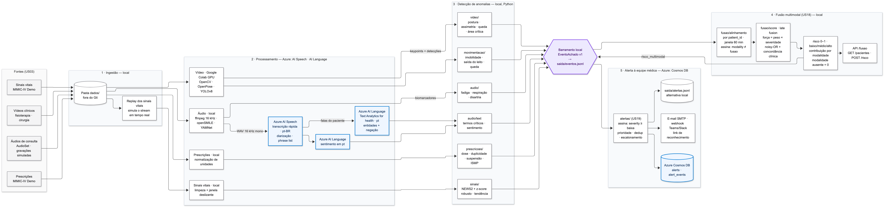
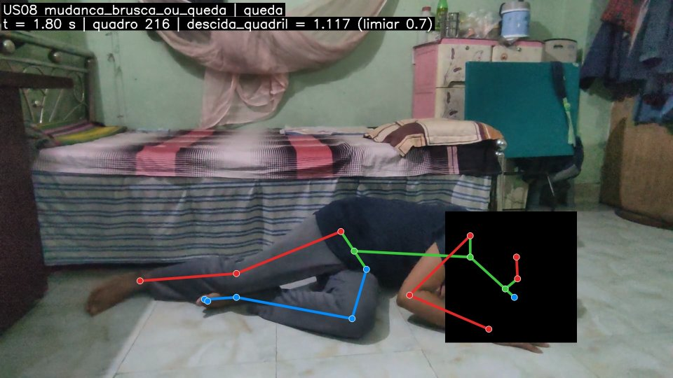

# Relatório técnico: monitoramento médico multimodal

**Tech Challenge, Fase 4 (US21).** Este relatório consolida a arquitetura, os modelos, os
resultados e as limitações do sistema. Os detalhes de cada história ficam nos relatórios de
rastreabilidade ao DoD em [`docs/`](.), citados em cada seção. Os caminhos são relativos à raiz
do repositório.

> **Aviso.** Este sistema **não é um dispositivo médico** e **não foi validado clinicamente**.
> É um trabalho acadêmico. Os achados indicam pontos para a equipe avaliar. Nenhum deles é
> diagnóstico nem substitui julgamento clínico. Os limiares e as prioridades de alerta são
> provisórios e precisam de revisão por profissionais de saúde antes de qualquer uso real.

## Sumário

1. [Escopo](#1-escopo)
2. [Fluxo multimodal](#2-fluxo-multimodal-us04)
3. [Modelos por tipo de dado](#3-modelos-por-tipo-de-dado)
4. [Resultados](#4-resultados)
5. [Exemplos de anomalias detectadas](#5-exemplos-de-anomalias-detectadas)
6. [Datasets, licenças e LGPD](#6-datasets-licenças-e-lgpd)
7. [Limitações e trabalhos futuros](#7-limitações-e-trabalhos-futuros)
8. [Referências](#8-referências)

## 1. Escopo

O sistema recebe quatro tipos de dado de pacientes internados ou em atendimento e publica
achados num contrato único, que alimenta um motor de alertas para a equipe:

| Tipo de dado | O que se detecta | US |
| --- | --- | --- |
| Vídeo (fisioterapia, leito, cirurgia) | postura fora da faixa, assimetria, queda, pessoa ou objeto em área crítica | US05 a US08 |
| Áudio de consulta | transcrição, termos clínicos críticos, sentimento negativo | US11, US13 |
| Sinais vitais | NEWS2, desvio da baseline do paciente, tendência de piora | US15 |
| Prescrições | mudança abrupta de dose, duplicidade, suspensão abrupta, alta vigilância | US16 |
| Movimentação na internação | imobilidade > 2 h, saída do leito à noite, queda, agitação ou redução de mobilidade | US17 |
| Alertas | prioridade, deduplicação, escalonamento, entrega e auditoria | US19 |

## 2. Fluxo multimodal (US04)



Fonte editável: [`arquitetura/fluxo_multimodal.mmd`](arquitetura/fluxo_multimodal.mmd) (o GitHub
renderiza). Regenerar: `bash scripts/renderizar_diagrama.sh`. Decisões, custos e serviços em
[`arquitetura/README.md`](arquitetura/README.md).

O fluxo tem cinco passos:

1. **Ingestão.** Arquivos em `dados/` e `conteudos/`, fora do Git e baixados por script. Os sinais
   vitais do MIMIC-IV Demo passam por um replay que entrega as medições em ordem, numa velocidade
   configurável, para simular o tempo real.
2. **Processamento por modalidade.** Vídeo com OpenCV, OpenPose e YOLOv8. Áudio com ffmpeg (WAV
   16 kHz mono), **Azure AI Speech** (transcrição) e **Azure AI Language** (Text Analytics for
   health e sentimento). Sinais vitais, prescrições e movimentação em Python local.
3. **Detecção.** Cada detector publica um `EventoAchado` v1
   ([contrato](arquitetura/contrato_eventos.md), JSON Schema em
   `contratos/schema/evento_achado.v1.schema.json`) no `BarramentoLocal`. O barramento valida cada
   evento e grava em `saida/eventos.jsonl`.
4. **Fusão** (US18, *late fusion* por paciente). Foi planejada e não está implementada (seção 7).
5. **Alerta.** O motor da US19 assina o barramento com `severity ≥ baixa`, aplica prioridade,
   deduplicação e escalonamento e envia por e-mail (SMTP) ou webhook (Teams/Slack). Grava log
   auditável em JSONL ou Azure Cosmos DB.

Os módulos não se chamam entre si; cada um só publica no contrato. Assim cada US é
desenvolvida e testada sozinha, e o motor de alertas funciona com qualquer combinação de
modalidades presentes. Os serviços Azure ficam só onde o desafio pede IA gerenciada (fala e NLP
clínico). Rodam em `brazilsouth`, então áudio e texto clínico não saem do país. O restante roda
local, com custo próximo de zero (≈ US$ 0,30 a 2 por rodada completa, com cache obrigatório das
respostas Azure em `saida/cache_azure/`).

Cada evento carrega `patient_id` pseudonimizado, `modality`, `event_type`, `timestamp`, `score`
(0 a 1), `severity` (`info`, `baixa`, `media`, `alta`) e `evidence`. A `evidence` tem `summary`
em português, `features` (valores observados), `thresholds` (limiares aplicados, com a versão) e
`artifacts` (quadro, trecho de áudio ou transcrição, por referência). Com isso, quem recebe o
alerta vê o valor que disparou a regra e a versão do limiar usado.

## 3. Modelos por tipo de dado

### 3.1 Vídeo

**Pré-processamento (US05).** OpenCV lê MP4/AVI e amostra a taxa configurada
(`VIDEO_TARGET_FPS=5`). Os rostos são anonimizados com o YuNet **antes** de qualquer gravação:
tarja sólida, margem de 15% e memória de 3 quadros.

**YOLOv8: objetos e áreas críticas (US07).** Detalhes no [relatório US07](relatorio_us07_dod.md).

| Item | Valor | Justificativa |
| --- | --- | --- |
| Modelo | `yolov8n.pt` (Ultralytics 8.4, pesos COCO) | Leve, roda em CPU e no Colab gratuito. Não houve fine-tuning: o repositório não tem rótulos clínicos |
| Classes | `person`, `bed`, `chair`, `couch`, `bottle` | Paciente ou cuidador e o mobiliário que define a borda e a lateral do leito |
| Confiança | `conf = 0,25` | Padrão Ultralytics, comparável à literatura |
| IoU (NMS e acerto) | `0,5` | Critério PASCAL VOC (mAP@0.5). O mesmo valor na inferência e na avaliação |
| Rastreamento | ByteTrack (`track_id`) | Entrada e saída pareadas por objeto e área |
| Áreas críticas | polígonos por câmera (`config/leito_uti_07.json`: `lateral_leito`, `borda_leito`) | Desenhados uma vez em resolução de referência e escalados |

**OpenPose: análise postural (US06, US08).** Detalhes no [relatório US08](relatorio_us08_dod.md).

| Item | Valor | Justificativa |
| --- | --- | --- |
| Modelo | OpenPose BODY_25 (Caffe, `cv2.dnn`), `video/pose/config.yaml` | 25 keypoints, inclusive pés e `MidHip`, que dão a escala do tronco |
| Entrada | altura 368 px, 10 fps | Padrão do OpenPose. Em CPU leva ~5× a duração do vídeo |
| Keypoint válido | confiança ≥ 0,3; esqueleto com ≥ 8 keypoints | Abaixo disso o ângulo fica ruidoso |
| Pós-processamento | pico 0,05; PAF 0,05; 80% de inliers | Valores do OpenPose original |

Regras de desvio da US08 (`config/us08_padroes.yaml`, versão **1.2.0**), com persistência mínima
de 1 s por padrão:

| Desvio | Regra |
| --- | --- |
| Postura e repetição (fisioterapia) | as 3 primeiras repetições, supervisionadas, viram a referência do paciente. As seguintes ficam a ±10° (abdução) ou ±15° joelho / ±20° tronco (agachamento) |
| Queda | centro do quadril desce ≥ 0,7 comprimento de tronco em ≤ 1 s e fica embaixo (janela 0,5 s) |
| Mudança brusca | tronco gira ≥ 60° em ≤ 0,5 s e se mantém |
| Presença indevida | classe proibida numa ROI da US07 por mais que o tolerado (borda do leito: 3 s) |

Os perfis de exercício comparam com a referência da própria sessão porque ângulos 2D mudam com a
pessoa e com a câmera. Um alvo absoluto de 130° na abdução separava as repetições corretas num
paciente e as invertia no seguinte.

### 3.2 Áudio

**Azure AI Speech: transcrição (US11).** API de transcrição rápida (síncrona, o áudio vai na
requisição, sem armazenamento intermediário), com diarização de até 2 falantes e timestamps por
frase e palavra. A *phrase list* `app/frases_medicas.txt` (81 termos clínicos em pt-BR) só é usada
se o WER passar de 20%. Custom Speech é o passo seguinte e não foi implementado. Retry em 429/5xx
(3 tentativas, respeita `Retry-After`) e cache por SHA-256 do áudio.

Limiares do WER, pela orientação da Microsoft: ≤ 20% aceitável (limite do projeto), 5 a 10% bom,
≥ 30% não aceitável.

**Azure AI Language: termos críticos e sentimento (US13).** Só as falas do **paciente** são
enviadas (a pergunta do médico não gera achado). Detalhes no [README](../README.md#termos-críticos-e-sentimento-nas-transcrições-us13).

| Item | Valor | Justificativa |
| --- | --- | --- |
| Text Analytics for health | `language: "pt"` (o serviço não tem `pt-BR`) | Direto em português, sem tradução que troque termo clínico |
| Filtro de asserção | descarta `negative`, `negative_possible`, associação `other`, `hypothetical`/`conditional`. `past` rebaixa a severidade um nível | "nego dor no peito" e "meu pai teve infarto" não são achados do paciente |
| Lista de termos | `audio/text/critical_terms.yaml`, 15 termos versionados com sinônimos e UMLS | Lista fechada, revisável pela equipe |
| Sentimento | `pt-BR` (com `pt` o serviço assume pt-PT). Sentença negativa se score ≥ 0,7; consulta negativa se ≥ 50% das sentenças | Evento `sentimento_negativo` de severidade baixa, que dá contexto à equipe sem disparar alerta urgente |

**Biomarcadores vocais (US12): não implementados.** A arquitetura prevê openSMILE/parselmouth
(F0, jitter, shimmer) e YAMNet para eventos respiratórios, e o catálogo do contrato já tem
`fadiga_vocal` e `desvio_baseline_vocal`. Nenhum extrator foi escrito. Motivos: o grupo priorizou
os detectores com dados reais rotulados (MIMIC, REHAB24-6, FallVision) e não encontrou dataset
aberto de voz clínica em português com rótulo de fadiga ou dispneia para validar o modelo. Ver
seção 7.

### 3.3 Detecção de anomalias

**Sinais vitais: NEWS2 + ML não supervisionado (US15).** Detalhes no [relatório US15](relatorio_us15_dod.md)
e no [desenho](arquitetura/us15_sinais_vitais.md).

| Camada | Método | Parâmetros e limiares |
| --- | --- | --- |
| Limpeza | faixas fisiológicas e validade limitada | SpO2 < 50 e FC > 300 são descartadas; o último valor vale por tempo limitado e depois o NEWS2 sai com `news2_parcial` |
| Clínica | NEWS2 (RCP 2017, SpO2 escala 1) por parâmetro e total | total 5 a 6 ou 3 num parâmetro → `news2_resposta_urgente` (média); total ≥ 7 → `news2_emergencia` (alta) |
| ML: mudança súbita | z-score robusto (mediana/MAD) sobre 12 h do próprio paciente | \|z\| > **2,5** em **2** medições seguidas; a baseline congela durante o episódio |
| ML: tendência | inclinação da regressão linear em 6 h, na escala da baseline | limiar **2,5** |

Os limiares de ML saíram de uma busca em grade só nos pacientes de `subject_id` par. Entre os
pontos de F1 parecido, foi escolhido o de maior recall, porque perder deterioração custa mais que
um falso alarme. A arquitetura citava Isolation Forest; a implementação usa z-score robusto porque
não precisa de treino, aprende com cada paciente desde as primeiras horas, é explicável (o z vai na
evidência) e cumpriu a meta. Tudo roda local, sem o Azure AI Anomaly Detector, que foi
descontinuado.

**Prescrições: regras + lista ISMP (US16).** Detalhes no [relatório US16](relatorio_us16_dod.md);
limiares em `config/us16_prescricoes.yaml` v1.0.0. As unidades são normalizadas antes de qualquer
comparação (mcg/g → mg, L → mL).

| Regra | Dispara quando |
| --- | --- |
| `mudanca_abrupta_dose` | dose diária do mesmo produto e via muda ≥ **50%** em relação às **24 h** anteriores |
| `duplicidade_terapeutica` | mesmo princípio ativo (também dentro de combinações), via sistêmica, sobreposição ≥ **6 h** |
| `suspensao_abrupta` | classe que exige desmame (betabloqueador, corticoide, opioide etc.) em uso ≥ **72 h** some sem retorno em **24 h**, com o paciente internado |
| `medicamento_alta_vigilancia` | primeira ordem na internação de uma das **19 classes** da lista ISMP 2024 / ISMP Brasil 2019 |

As exceções vieram dos dados: PRN, ordens tituladas, esquema basal + correção de insulina, troca
de prescrição (`Inactive (Due to a change order)`), desmame prévio ≥ 25%, suspensão perto da alta.
Insulina, anticoagulante e opioide na introdução ficam em severidade baixa: são 55% das
introduções e, em média, gerariam 5,7 alertas por internação (fadiga de alarme).

**Movimentação: NPIAP/EPUAP + baseline (US17).** Detalhes no [relatório US17](relatorio_us17_dod.md);
limiares em `config/us17_movimentacao.yaml` v1.3.0. Duas fontes geram a mesma série: vídeo (pose, áreas da
US07, caixa do YOLOv8) e registro de enfermagem do MIMIC-IV (`Position`, `Turn`, `Activity`).

| Regra | Limiar |
| --- | --- |
| `imobilidade_prolongada` | > **120 min** sem mudança de posição (NPIAP/EPUAP), média; alta a partir de 240 min. Lacuna > 150 min não conta |
| `saida_do_leito` | alta à noite (22:00 a 06:00), média de dia |
| `queda` | sempre alta. Pelo vídeo: centro da caixa `person` desce ≥ **0,065** da altura do quadro em ≤ 1,5 s e fica embaixo 0,5 s |
| `agitacao_subita` / `reducao_mobilidade` | taxa de 6 h ≥ 2× ou ≤ 0,5× a baseline de 24 h do paciente (mínimo 12 h e 3 eventos de histórico) |

### 3.4 Motor de alertas (US19)

[Relatório US19](relatorio_us19_dod.md), `config/alertas_regras.yaml`. O motor conhece só o
contrato, então aceita qualquer `event_type` do catálogo sem mudar código.

- **Prioridade em 3 níveis** (alta, média, baixa), na linha da IEC 60601-1-8. `info` nunca alerta.
- **Fadiga de alarme:** deduplicação por `paciente | modalidade | event_type` em janela de 5 min
  (alta), 15 min (média) ou 60 min (baixa). Escalonamento por persistência (contagem ou tempo).
- **Entrega:** SMTP e webhook, com outbox (`pending` gravado antes do envio), retentativa
  exponencial (5, 10, 20 s) e recuperação ao reiniciar. Reconhecimento por link com token HMAC.
- **Registro:** `saida/alertas.jsonl` + trilha append-only, ou Cosmos DB. Painel em
  `GET /alerts/dashboard`.

## 4. Resultados

Todos os números foram medidos e podem ser reproduzidos pelos scripts citados. Em toda avaliação, os
limiares foram ajustados numa partição e o número reportado vem de outra.

| US | Métrica | Meta | Obtido | Atingida? | Observação |
| --- | --- | --- | --- | :---: | --- |
| US07 | mAP@0.5 (COCO val2017, `yolov8n`) | sem meta (braço sem fine-tuning) | **0,528** | n/a | `saida/video/metricas_coco_val2017.json` |
| US07 | mAP@0.5:0.95 · Precision · Recall | n/a | **0,366** · **0,637** · **0,487** | n/a | Confere com o model card (0,373) |
| US07 | AP@0.5 das classes de interesse | n/a | person 0,503 · bed 0,425 · couch 0,431 · bottle 0,296 · chair 0,253 | n/a | |
| US07 | mAP@0.5 por classe médica após fine-tuning | ≥ 0,50 | não medido | ✘ | Sem rótulos clínicos no repositório. O gate (`scripts/dataset_us07.py treinar`) está pronto |
| US08 | Precision por evento (teste) | ≥ 0,70 | **0,71** | ✔ | 35 eventos, `scripts/avaliar_us08.py` |
| US08 | Recall por evento (teste) | ≥ 0,80 | **0,52** | ✘ | Queda só por pose tem recall 0,23 no FallVision. Abdução e agachamento ficam em 0,64 |
| US11 | WER (Azure Speech) | ≤ 20% | não medido | ✘ | Rodada de 06/11/2026: os 10 áudios do Eka voltaram HTTP 401. A assinatura Azure do grupo está desativada (seção abaixo). Reproduzir: `python scripts/avaliar_wer.py --baixar 10` |
| US13 | Precision / Recall / F1 de termos críticos | sem meta fixa | não medido | n/a | Mesma assinatura desativada; `AZURE_LANGUAGE_KEY` também está vazia no `.env`. Reproduzir: `python scripts/eval_us13.py` |
| US12 | Biomarcadores vocais | n/a | não implementado | ✘ | Seção 3.2 |
| US15 | Recall (teste, 50 pacientes, 2.924 slots) | ≥ 0,80 | **0,838** | ✔ | VP 1.264 · FN 244 · FP 574 · VN 842 |
| US15 | Precision (teste) | n/a | **0,688** | n/a | Piso: parte dos FP é piora real sem rótulo |
| US15 | F1 (teste) | ≥ 0,70 | **0,756** | ✔ | `saida/sinais/relatorio_us15.json` |
| US15 | Latência por medição | tempo real | ~0,1 ms | ✔ | Janela deslizante em `deque` |
| US16 | Recall (casos injetados, modo realista) | ≥ 0,80 | **0,974** (IC95 0,967 a 0,980) | ✔ | Cada tipo ≥ 0,94. FP em controles 1,5%. `saida/prescricoes/avaliacao_us16.json` |
| US16 | Recall (modo controlado) | ≥ 0,80 | **1,000** | ✔ | FP 0,4% |
| US17 | Recall de queda em vídeo real (teste) | ≥ 0,80 | **0,875** (14/16, IC95 0,64 a 0,97) | ✔ (pontual) | O limite inferior do IC fica abaixo de 0,80. Alarme falso 1/5 |
| US17 | Recall nos casos injetados no MIMIC | n/a | queda 1,00 · saída noturna 1,00 · imobilidade 1,00 · agitação 0,988 · redução 0,822 | n/a | Verifica a lógica, não a percepção |
| US19 | Latência ingestão → envio, p95, canal local | ≤ 10 s | **0,004 s** (p50 0,002 · máx 0,026) | ✔ | 100 achados, webhook HTTP local: mede só o overhead do motor |
| US19 | Latência ingestão → envio, p95, **e-mail SMTP real** | ≤ 10 s | **54,97 s** (p50 34,99 · máx 54,97) | ✘ | 10 achados simultâneos, 9 enviados. `saida/latencia_us19_smtp.json` |

### Metas não atingidas e por quê

- **US07, fine-tuning em classes médicas.** Não há dataset clínico anotado com licença
  compatível. O pipeline de treino e o gate por classe existem, mas sem rótulos não há número para
  declarar.
- **US08, recall de 0,52.** O ponto fraco é a queda vista só pela pose: nos clipes curtos do
  FallVision a pessoa aparece em menos de 50% dos quadros, ou o clipe acaba logo após o impacto.
  Na abdução, uma referência contaminada (PM_039 começa com repetição incorreta) derruba o recall.
  A US17 mostrou a correção: com a descida da caixa do YOLOv8, o recall de queda vai a 0,875.
- **US11 e US13, não medidos.** Na rodada de 06/11/2026 com o `.env` do grupo, o Speech
  respondeu HTTP 401 aos 10 áudios, em `eastus` e em `brazilsouth`. O Cosmos DB, na mesma
  assinatura, respondeu `Forbidden: Subscription owning the database account is disabled`. A
  assinatura Azure está desativada (o crédito do Azure for Students para os recursos quando
  acaba). A US13 também não tem `AZURE_LANGUAGE_KEY`. Os scripts estão prontos e testados com a
  API simulada (`pytest audio/tests`). Reativada a assinatura, basta rodá-los e copiar os números.
  Não há dataset de referência em pt-BR, por isso o WER usa o Eka Medical ASR em inglês indiano.
  Esse desvio do DoD fica registrado.
- **US19, latência com e-mail real (p95 55 s).** O motor leva 4 ms. O tempo vem da entrega: o
  `Despachante` (`alertas/despachante.py`) envia um alerta por vez, e o `NotificadorEmail` abre
  uma conexão SMTP nova a cada e-mail (STARTTLS + login, ~5,5 s no provedor). Com 10 alertas
  simultâneos, o décimo espera os nove anteriores, e a latência cresce em linha reta (p50 35 s).
  Um alerta isolado sai em ~5 s, dentro da meta, mas uma rajada não. Um dos 10 e-mails falhou na
  primeira tentativa e ficou para retentativa. Correção proposta: reutilizar a conexão SMTP e
  enviar em paralelo por canal (seção 7).
- **US12.** Não implementada (seção 3.2).

## 5. Exemplos de anomalias detectadas

Um exemplo por tipo, com o evento resumido e a evidência. IDs de paciente são pseudônimos HMAC.

### 5.1 Vídeo: queda (FallVision `B_N_03`, perfil `internacao_leito`)

O quadril desceu 1,1 comprimento de tronco em 0,5 s e ficou embaixo. Quadro 216 (1,80 s),
anonimizado:



```json
{"modality": "video", "event_type": "mudanca_brusca_ou_queda", "severity": "alta", "score": 0.7087,
 "evidence": {"summary": "Possível queda aos 0,9 s: o quadril desceu 1,1 comprimentos de tronco em 0,5 s e ficou embaixo por 1,1 s.",
   "features": {"regra": "queda", "valor": 1.117, "frame_index": 216},
   "thresholds": {"versao_limiares": "1.1.0", "limiar": 0.7, "janela_minima_s": 0.5}}}
```

Outro desvio real (repetição incorreta de abdução, REHAB24-6 `PM_001`, ombro em 122° contra 135°
da referência): [`evidencias/us08/rehab24_PM_001_repeticao8_81.80s.jpg`](evidencias/us08/rehab24_PM_001_repeticao8_81.80s.jpg).
Entrada e saída de área crítica (US07, `B_D_0016`, 10 eventos pareados):
`saida/video/eventos_us07.jsonl` e `saida/video/rois_leito_uti_07.jpg`.

### 5.2 Áudio: termo crítico afirmado e negação descartada (US13)

Consulta simulada `data/text_samples/consulta-01.json`, anotada em
`data/text_samples/annotations.csv`. O paciente diz "estou com uma dor no peito muito forte". O
médico pergunta "você sente falta de ar?" e o paciente nega febre. Saída esperada: um
`termo_critico` para dor torácica e nenhum achado para a pergunta do médico nem para a febre
negada.

```json
{"modality": "texto", "event_type": "termo_critico", "severity": "alta",
 "evidence": {"summary": "Paciente relata dor torácica: “dor no peito” (afirmado, sem negação)",
   "features": {"termo": "dor torácica", "nome_normalizado": "Chest Pain", "certeza": "positive",
                "associacao": "subject", "falante": "paciente", "offset_ms": 6512},
   "artifacts": [{"kind": "transcricao", "uri": "data/text_samples/consulta-01.json", "start_ms": 3615, "end_ms": 11675}]}}
```

> Este evento mostra o formato com valores ilustrativos (o score do serviço não está nele). A
> rodada real com o Azure AI Language grava o exemplo medido em `outputs/text_analysis/eval.md`,
> que deve substituir este bloco.

### 5.3 Sinais vitais: NEWS2 de emergência (MIMIC-IV Demo, replay)

Gerado por `python scripts/rodar_us15.py --velocidade 0 --pacientes 3` (o replay reescreve o
horário para o instante da execução):

```json
{"modality": "sinais_vitais", "event_type": "news2_emergencia", "severity": "alta",
 "patient_id": "pt_b00c3ff10002574317845f45",
 "evidence": {"summary": "NEWS2 = 8 (fr 24, pas 84, fc 91, o2_suplementar 1): emergência",
   "features": {"fr_irpm": 24, "pas_mmhg": 84, "fc_bpm": 91, "spo2_pct": 98, "temp_c": 37.06, "o2_suplementar": 1,
                "news2_fr": 2, "news2_pas": 3, "news2_fc": 1, "news2_o2_suplementar": 2, "news2_total": 8,
                "news2_parcial": true, "news2_ausentes": "alerta"},
   "thresholds": {"news2_urgente_total": 5, "news2_emergencia_total": 7, "news2_parametro_unico": 3}}}
```

Na mesma rodada, a camada de ML marcou `desvio_baseline` noutro paciente: "pas 89 desvia da
baseline do paciente (mediana 105, z = -2.7)", limiar |z| 2,5 em 2 medições.

### 5.4 Prescrições: mudança abrupta de anticoagulante (MIMIC-IV Demo)

`pt_472b69fdffa5894af2fbb0c0`, ordens 41490219 → 58986734, `mudanca_abrupta_dose`, média,
score 1,0:

> Dose de Enoxaparin Sodium (SC) subiu 400% (40 → 200 mg/dia), 1 h depois do fim da anterior.
> Antes: 40 mg QPM (40 mg/dia); depois: 100 mg Q12H (200 mg/dia). Limiar: ±50% em 24 h.

Profilaxia trocada por dose plena. Pode ser conduta correta (trombose diagnosticada), mas
anticoagulante cinco vezes maior de uma hora para outra pede dupla checagem de peso e função
renal. Outros três casos reais, um de cada tipo, no [relatório US16](relatorio_us16_dod.md#anomalias-reais-do-mimic-iv-demo-item-7).

### 5.5 Movimentação: imobilidade prolongada (MIMIC-IV Demo)

Em `saida/movimentacao/mimic_eventos.jsonl` (861 eventos válidos de 139 estadias):

```json
{"modality": "movimentacao", "event_type": "imobilidade_prolongada", "severity": "alta", "score": 1.0,
 "patient_id": "pt_c2e6536fb12486a755b270c0",
 "evidence": {"summary": "4 h 00 min sem mudança de posição no leito",
   "features": {"minutos_sem_mudanca": 240.0, "reposicionamentos_por_hora": 0.426},
   "thresholds": {"limiar_min": 120.0, "lacuna_max_min": 150.0, "severidade_acima_de_min": "240:alta", "versao_limiares": "1.3.0"}}}
```

Queda em vídeo real pela descida da caixa: `python -m movimentacao.run video --video conteudos/videos/B_D_0002.mp4`
gera um evento `queda` de severidade alta.

## 6. Datasets, licenças e LGPD

### Datasets

Nenhum dado bruto é versionado. Tudo é baixado por script para `dados/`, `data/` ou `conteudos/`,
que estão no `.gitignore`. Ficam no Git só os resultados agregados, as anotações próprias e as
evidências anonimizadas.

| Dataset | Uso | Licença |
| --- | --- | --- |
| [MIMIC-IV Clinical Database Demo 2.2](https://physionet.org/content/mimic-iv-demo/2.2/) (PhysioNet) | sinais vitais (US15), prescrições (US16), enfermagem (US17) | ODbL v1.0 |
| REHAB24-6 (Černek et al., 2024) | fisioterapia, pose e desvios (US06, US08) | CC BY-NC 4.0, uso não comercial com atribuição |
| FallVision (clipes de leito) | queda (US08, US17) | conferir no repositório de origem antes de redistribuir. Os clipes não são versionados |
| [COCO val2017](https://cocodataset.org/) | métricas do YOLOv8 (US07) | anotações CC BY 4.0; imagens sob os termos do Flickr |
| [Eka Medical ASR Evaluation](https://huggingface.co/datasets/ekacare/eka-medical-asr-evaluation-dataset) | WER (US11) | MIT |
| [PriMock57](https://github.com/babylonhealth/primock57) (Babylon Health, 2022) | transcrições de consultas simuladas (US13) | CC BY 4.0 |
| [MedPT](https://huggingface.co/datasets/AKCIT/MedPT) (AKCIT, 2026) | perguntas reais de pacientes em pt-BR (US13) | card sem licença: o texto fica fora do Git, só IDs e rótulos são versionados |
| `data/text_samples/` (15 consultas) | NLP em pt-BR (US13) | criadas pelo grupo, simuladas |
| Pesos `yolov8n.pt` e OpenPose BODY_25 | inferência | AGPL-3.0 (Ultralytics); OpenPose: licença acadêmica não comercial da CMU |

### Tratamento LGPD

Dados de saúde são dados pessoais sensíveis (LGPD, art. 5º, II). As medidas:

| Medida | Como |
| --- | --- |
| Pseudonimização na borda (art. 13 §4º) | `patient_id` e `encounter_id` viram `pt_<24 hex>` por HMAC-SHA256 com `PSEUDONYM_KEY` (≥ 32 bytes, só no `.env`), em `contratos/pseudonimizacao.py`. É determinístico para a fusão cruzar modalidades e irreversível sem a chave. Nenhum `subject_id` cru aparece no evento (testado) |
| Anonimização de imagem | rostos tarjados antes de qualquer gravação (YuNet). Nos quadros de evidência, a cabeça é tarjada pelos keypoints do rosto |
| Minimização | só as falas do paciente vão ao NLP. Evidência por referência: o evento guarda o caminho, não o conteúdo. Alertas não trazem nome |
| Localização dos dados (art. 33) | Azure Speech e Language em `brazilsouth`, então áudio e texto não saem do país. A transcrição rápida não guarda o áudio em armazenamento na nuvem |
| Segredos | sem chave no Git. A arquitetura alvo usa `DefaultAzureCredential` com função RBAC mínima ([`azure-funcao-minima.json`](arquitetura/azure-funcao-minima.json)); em produção, a chave HMAC iria para o Key Vault |
| Base dos dados | só dados públicos e desidentificados na origem (MIMIC) ou simulados. MIMIC desloca as datas para o futuro |
| Auditoria | barramento e alertas em JSONL append-only, com reconhecimento por token HMAC |

Não houve coleta de dados de pessoas reais pelo grupo. Um uso clínico real exigiria base legal
(art. 11), relatório de impacto (RIPD), contrato de operador com a Microsoft e política de
retenção, e o grupo não fez nenhum deles.

## 7. Limitações e trabalhos futuros

**Não é dispositivo médico validado clinicamente.** Nenhum limiar, prioridade ou regra foi
revisado por equipe clínica nem avaliado prospectivamente. Uso assistencial exigiria validação
clínica e enquadramento regulatório (ANVISA, RDC 657/2022, software como dispositivo médico).

**Limitações**

- **Avaliação com rótulo sintético ou pequeno.** US15, US16 e US17 (MIMIC) medem anomalias
  injetadas, não eventos clínicos reais. US17 tem 16 quedas no teste, com rótulos que ainda pedem
  conferência humana.
- **Vídeo.** Ângulos 2D dependem da câmera. A referência de fisioterapia só vale se as 3 primeiras
  repetições forem corretas. Câmera vista de cima não mostra queda como descida. A US07 não separa
  paciente de profissional. Sem fine-tuning, não há classes cirúrgicas. Rostos pequenos, inclinados
  ou cobertos podem escapar da anonimização.
- **Áudio.** WER e US13 sem rodada real nesta entrega. Não há dataset de referência em pt-BR.
  O Text Analytics for health é mais maduro em inglês. A API GA não devolve temporalidade, então o
  passado é inferido por marcadores locais.
- **Prescrições.** O MIMIC registra ordens, não administrações. Sem peso nem indicação, toda mudança
  grande de dose é anomalia, mesmo quando é a conduta certa. O princípio ativo vem de vocabulário
  próprio, não do RxNorm.
- **Tempo real.** Só os sinais vitais são streaming (replay). Vídeo e áudio são processados por
  arquivo.
- **Alertas.** Com SMTP real, a entrega em série estoura a meta de 10 s em rajadas. Teams e
  Slack reais não foram testados (sem `ALERTA_WEBHOOK_URL`). O armazenamento no Cosmos DB não foi
  validado contra a conta real, por causa da assinatura desativada. Azure Communication Services
  Email não foi implementado.
- **Dependência da assinatura Azure.** Transcrição, NLP clínico e Cosmos param juntos quando a
  assinatura é desativada. Vídeo, sinais vitais, prescrições, movimentação e alertas por SMTP
  continuam funcionando, porque rodam local.

**Trabalhos futuros**

1. **Fusão multimodal (US18):** *late fusion* ponderada por paciente e janela, publicando
   `risco_multimodal` com `related_event_ids`.
2. **Biomarcadores vocais (US12):** openSMILE (eGeMAPS) e parselmouth para F0, jitter, shimmer e
   HNR com baseline por paciente; YAMNet para tosse e dispneia.
3. **Rodar WER e US13 com os recursos Azure** e, se o WER passar de 20%, Custom Speech em pt-BR
   (treino em `eastus`, cópia para `brazilsouth`).
4. **Fine-tuning do YOLOv8** em classes médicas (instrumentos, monitores) com o gate por classe
   ≥ 0,50 já implementado.
5. **Calibrar postura pela pose** em vídeo real de leito e confirmar pelo fisioterapeuta a série
   de referência.
6. **Produção na Azure:** Event Hubs/IoT Hub na ingestão, Service Bus no lugar do barramento
   (sessões por `patient_id`), Functions ou Container Apps, Key Vault, Application Insights e
   Health Data Services (FHIR). Ver [arquitetura](arquitetura/README.md#evolução-para-produção-trabalhos-futuros).
7. **Entrega de alertas em paralelo:** conexão SMTP reutilizada (ou ACS Email, que é HTTP) e
   envio concorrente por canal no `Despachante`, para p95 ≤ 10 s também em rajadas.
8. **Validação clínica** dos limiares e prioridades com a equipe, e estudo retrospectivo com
   eventos reais rotulados.

## 8. Referências

1. Royal College of Physicians. *National Early Warning Score (NEWS) 2: Standardising the
   assessment of acute-illness severity in the NHS.* London: RCP, 2017.
2. Microsoft. *Test accuracy of a Custom Speech model* (Word Error Rate). Microsoft Learn,
   Azure AI Speech. https://learn.microsoft.com/azure/ai-services/speech-service/how-to-custom-speech-evaluate-data
3. IEC 60601-1-8:2006+A1:2012+A2:2020. *Medical electrical equipment, Part 1-8: General
   requirements for basic safety and essential performance. Collateral standard: General
   requirements, tests and guidance for alarm systems in medical electrical equipment and medical
   electrical systems.*
4. Institute for Safe Medication Practices. *ISMP List of High-Alert Medications in Acute Care
   Settings*, 2024. ISMP Brasil. *Medicamentos potencialmente perigosos de uso hospitalar: lista
   atualizada 2019.* Boletim ISMP Brasil, v. 8, n. 1, 2019.
5. European Pressure Ulcer Advisory Panel, National Pressure Injury Advisory Panel, Pan Pacific
   Pressure Injury Alliance. *Prevention and Treatment of Pressure Ulcers/Injuries: Clinical
   Practice Guideline.* 3rd ed. EPUAP/NPIAP/PPPIA, 2019.
6. Cao, Z.; Hidalgo, G.; Simon, T.; Wei, S.-E.; Sheikh, Y. OpenPose: Realtime Multi-Person 2D
   Pose Estimation Using Part Affinity Fields. *IEEE TPAMI*, 43(1), 2021.
7. Jocher, G.; Chaurasia, A.; Qiu, J. *Ultralytics YOLOv8*, 2023. https://github.com/ultralytics/ultralytics
8. Zhang, Y. et al. ByteTrack: Multi-Object Tracking by Associating Every Detection Box. *ECCV*,
   2022.
9. Lin, T.-Y. et al. Microsoft COCO: Common Objects in Context. *ECCV*, 2014.
10. Everingham, M. et al. The PASCAL Visual Object Classes (VOC) Challenge. *IJCV*, 88, 2010.
11. Johnson, A. et al. *MIMIC-IV Clinical Database Demo* (v2.2). PhysioNet, 2023.
    https://physionet.org/content/mimic-iv-demo/2.2/
12. Goldberger, A. et al. PhysioBank, PhysioToolkit, and PhysioNet. *Circulation*, 101(23), 2000.
13. Černek, A.; Sedmidubsky, J.; Budikova, P. REHAB24-6: Physical Therapy Dataset for Analyzing
    Pose Estimation Methods. *SISAP*, Springer, 2024.
14. Korfiatis, A. P. et al. PriMock57: A Dataset of Primary Care Mock Consultations. *ACL*, 2022.
15. Microsoft. *Text Analytics for health* e *Sentiment analysis*. Microsoft Learn, Azure AI Language.
16. Iglewicz, B.; Hoaglin, D. *How to Detect and Handle Outliers* (z-score modificado com MAD).
    ASQC, 1993.
17. Brasil. Lei nº 13.709/2018 (Lei Geral de Proteção de Dados Pessoais). ANVISA, RDC nº 657/2022
    (software como dispositivo médico).
