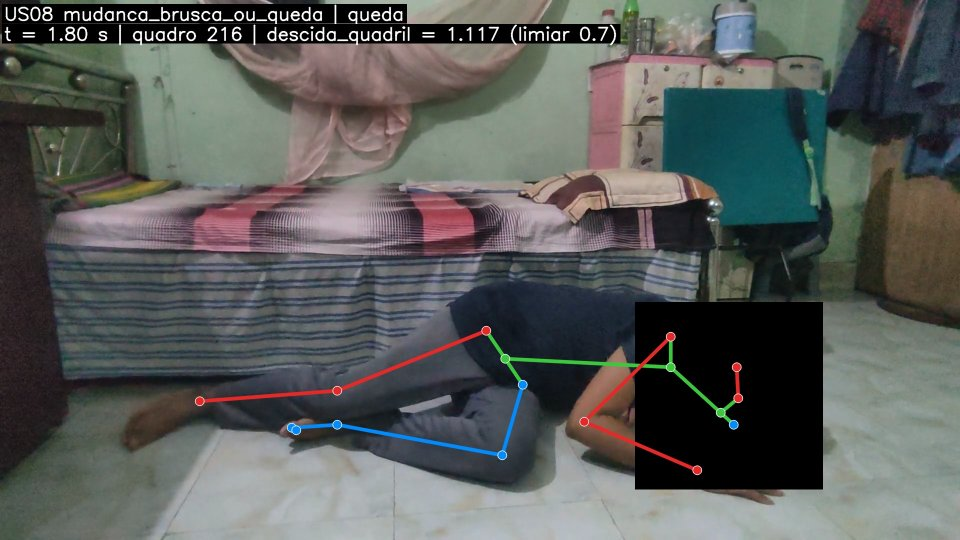
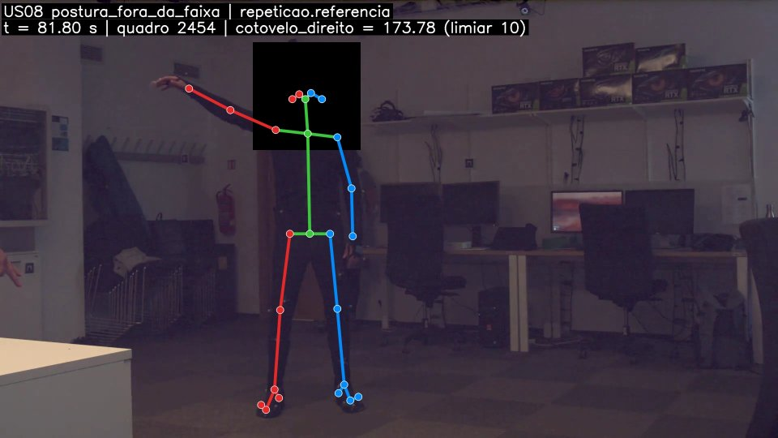

# Relatório US08 — rastreabilidade ao Definition of Done

**US08 · Detectar movimentos e eventos fora do padrão no vídeo.** A fonte de
verdade é o enunciado do Tech Challenge (Fase 4, "1. Análise de Vídeo"):
*processar vídeos clínicos (fisioterapia ou cirurgia), detectar movimentos ou
eventos fora do padrão esperado com OpenPose (análise postural) e YOLOv8
(objetos e áreas críticas) e gerar relatórios automáticos indicando desvios ou
falhas no procedimento.* O DoD abaixo é a proposta do grupo para cumprir esse
item; cada linha aponta o código, a configuração e o *status* real.

Os caminhos são relativos à raiz do repositório.

## Fluxo

```text
vídeo ─► US06 OpenPose ─► keypoints + ângulos por quadro ─┐
     └─► US07 YOLOv8 ─► entrada/saída de área crítica ────┤
                                                          ▼
              config/us08_padroes.yaml (perfil do tipo de vídeo, limiares versionados)
                                                          ▼
     video/desvios/regras.py + areas.py ─► desvios que persistiram pela janela mínima
                                                          ▼
     video/desvios/eventos.py ─► EventoAchado (US04) ─► fusão (US18) / alertas (US19)
     video/desvios/evidencia.py ─► quadro de evidência anonimizado (JPG)
     video/desvios/run.py ─► <fonte>_eventos.jsonl + <fonte>_relatorio.json
```

A US08 não chama a US06 nem a US07: lê o que elas gravam (JSON de pose e JSONL de
eventos). Assim cada US roda e é testada sozinha, como pede a arquitetura
([`docs/arquitetura/README.md`](arquitetura/README.md)).

## Quadro DoD → código

### 1. "Padrão esperado" definido explicitamente por tipo de vídeo

**Status:** ✔ implementado.

[`config/us08_padroes.yaml`](../config/us08_padroes.yaml) tem um perfil por tipo de
vídeo (`tipo_video`: `fisioterapia`, `leito`, `cirurgia`), cada um com
`descricao` do padrão em português e as regras que o verificam:

| Perfil | Padrão esperado |
| --- | --- |
| `fisioterapia_geral` | tronco até 30°, joelho não abaixo de 45°, assimetria até 20° (os critérios do feedback da US06) |
| `fisioterapia_abducao_ombro_frontal` | as 3 primeiras repetições (supervisionadas) definem amplitude do ombro e extensão do cotovelo; as seguintes ficam a ±10° delas; tronco até 20°; série de 5 a 10 repetições |
| `fisioterapia_agachamento` | as 3 primeiras repetições definem a flexão dos dois joelhos e a inclinação do tronco; as seguintes ficam a ±15° (joelhos) e ±20° (tronco) delas; 5 a 10 repetições, de frente ou a 45° |
| `internacao_leito` | sem queda, sem giro brusco do tronco, ninguém na borda do leito por mais de 3 s |
| `cirurgia` | ninguém na área restrita, nenhum celular/garrafa/copo no campo estéril |

- **Leitura e validação:** `video/desvios/config.py` recusa chave desconhecida,
  coluna de ângulo inexistente, severidade fora do catálogo e combinação
  incoerente (alvo aquém do repouso), na carga.
- **Ângulos 2D:** os ângulos da US06 são projeções, então um limiar absoluto
  muda com a pessoa e com a posição da câmera. Os perfis de exercício comparam
  com a série de referência da própria sessão, o que absorve as duas coisas;
  limiares absolutos ficam para critérios gerais (`fisioterapia_geral`) e de
  segurança.
- **Repetições:** `video/desvios/regras.py::repeticoes` separa as repetições
  pelo ângulo principal (trecho fora do `repouso`), conta e compara com
  `esperadas`. Repetição cortada no início ou no fim do vídeo não conta.

**Decisão — padrão do próprio paciente na abdução.** A primeira versão usava um
alvo absoluto (ombro ≥ 130°), calibrado em PM_001, em que as corretas chegam a
132–138° e as incorretas a 122–129°. Em PM_012 é o contrário: corretas 119–126°,
incorretas 140–149°. Ângulo 2D "certo" depende da pessoa e da câmera, então o
perfil passou a usar `referencia`: as 3 primeiras repetições da sessão, feitas
com o fisioterapeuta, viram o padrão daquele paciente, e cada repetição
seguinte é comparada a ele na fase de pico (`fase_pico_graus`). O alvo absoluto
continua disponível (`alvo`) para exercícios em que ele generaliza.

**Decisão — o agachamento seguiu o mesmo caminho (v1.2.0).** Na v1.1.0 o
agachamento tinha dois perfis por vista com limiares absolutos calibrados em
PM_029 (assimetria ≤ 25° de frente, tronco ≤ 20° a 45°). No teste com PM_038 e
PM_043 eles marcaram todas as 12 repetições corretas a 45°. A v1.2.0 troca os
dois por um perfil com `referencia` nos joelhos e no tronco, calibrado em
PM_029, PM_038 e PM_043, e foi medida em vídeos novos (PM_105, PM_126).

### 2. Detecta: postura fora da faixa, assimetria, mudança brusca/queda, pessoa/objeto em área crítica

**Status:** ✔ implementado — os quatro `event_type` já estavam no catálogo da
modalidade `video` (`contratos/catalogo.py`), nenhum schema mudou.

| Desvio | Regra | `event_type` |
| --- | --- | --- |
| Ângulo fora de `[min, max]` | `regras.py::desvios_de_faixa` | `postura_fora_da_faixa` |
| Repetição sem amplitude ou fora da referência | `regras.py::repeticoes` | `postura_fora_da_faixa` |
| \|esq − dir\| acima do limiar | `regras.py::desvios_de_faixa` (colunas `assimetria_*`) | `assimetria_movimento` |
| Queda: centro do quadril desce ≥ 0,7 tronco em ≤ 1 s e não volta | `regras.py::desvios_de_queda` + `sinais.py::saltos_mantidos` | `mudanca_brusca_ou_queda` |
| Mudança brusca: tronco gira ≥ 60° em ≤ 0,5 s e fica | `regras.py::desvios_de_mudanca_brusca` | `mudanca_brusca_ou_queda` |
| Classe proibida em ROI da US07 por mais que o tolerado | `areas.py::desvios_de_areas` | `presenca_indevida_area_critica` |

- A queda usa o **comprimento do tronco** (pescoço→quadril) como escala, o que
  independe da distância da câmera e da resolução.
- Depois da queda a pessoa costuma sair do quadro ou ficar ocluída; quadro sem
  keypoint não conta como "levantou" (`ausencia_mantem`), só uma medida de volta
  acima conta. Sem isso duas quedas de calibração (B_N_43 e B_N_45) escapavam.
- Giro de tronco que acontece junto com uma queda não gera segundo evento.
- Presença indevida pareia `entrada`/`saida` do mesmo `track_id` na mesma área e
  cita os dois eventos da US07 em `related_event_ids`; uma entrada sem saída
  vale até o fim do vídeo.
- Sem pose, um perfil misto (leito) avalia só as áreas e se declara não
  confiável, para não publicar `sem_achados` sobre postura não avaliada.

### 3. Evento só dispara se o desvio persistir por janela mínima configurável

**Status:** ✔ implementado.

- `geral.janela_minima_s: 1.0` é o padrão; cada regra pode ter `janela_s`
  própria (0,5 s na queda e na mudança brusca, 3 s na borda do leito). Nas
  regras por repetição, a persistência é a duração mínima da repetição
  (`duracao_min_s: 1.0`): o desvio é o movimento inteiro.
- `sinais.py::trechos` junta trechos separados por até `geral.lacuna_max_s`
  (0,3 s, um ou dois quadros perdidos) e descarta os mais curtos que a janela.
- Queda e mudança brusca exigem que a posição nova se mantenha por `janela_s`
  com pelo menos `fracao_permanencia` (70%) do salto; vídeo que acaba antes não
  confirma.
- A janela e a versão dos limiares vão em `evidence.thresholds` de cada evento.

### 4. Avaliação em vídeos rotulados: Recall ≥ 0,80 e Precision ≥ 0,70 por evento

**Status:** ✘ meta **não atingida** no teste. Na versão atual (limiares v1.2.0)
a precisão cumpre a meta (**0,71**) e o recall não (**0,52**, puxado pela queda).
Medida, protocolo e causas abaixo.

**Dados rotulados (normal × desvio):**

- **REHAB24-6** (`data/rehab24/Segmentation.csv`): cada repetição tem
  `correctness` (0 = execução incorreta). Avaliados o exercício 1 (abdução, vista
  frontal) e o exercício 6 (agachamento, frontal e a 45°), câmera 17.
- **FallVision** (`data/fallvision`): clipes de 2–8 s rotulados pela pasta
  `Fall` / `No Fall` (cenário leito). Amostra sorteada (semente 8) de 20 + 20.

**Protocolo** (`scripts/avaliar_us08.py`, `video/desvios/avaliacao.py`):

- Unidade = repetição (REHAB24-6) ou clipe (FallVision). Cada evento é
  atribuído à unidade com que mais se sobrepõe; evento em unidade com desvio é
  acerto, em unidade normal ou entre repetições é falso positivo.
  `precisão = eventos certos / eventos`, `recall = unidades com desvio detectadas / unidades com desvio`.
- Cada bloco contínuo de repetições na mesma vista é uma sessão (o vídeo é
  recortado no trecho dele; PM_105 tem dois blocos de frente separados por um a
  45°). Com perfil de referência, as 3 primeiras repetições da sessão não entram
  na conta (são a série supervisionada).
- **Calibração × teste.** Os limiares de cada versão foram fixados antes de
  rodar o teste daquela versão, ajustando só na calibração. Teste visto não
  volta a ser teste: ele passa para a calibração da versão seguinte.

  | Versão | Calibração | Teste |
  | --- | --- | --- |
  | 1.1.0 | PM_001, PM_012¹, PM_029; 18 clipes FallVision | PM_023, PM_038, PM_043; 24 clipes |
  | 1.2.0 | + PM_038, PM_043 | PM_023, PM_032, PM_039, PM_105, PM_126; os mesmos 24 clipes² |

  ¹ PM_012 começou no teste e foi movido porque revelou o problema do alvo
  absoluto. ² A regra de queda não mudou da 1.1.0 para a 1.2.0, nem a da
  abdução, então PM_023 e os clipes continuam válidos como teste.
- Extração de pose a ~1,4 s/quadro em CPU limitou o conjunto de teste; a ordem
  dos vídeos foi fixada antes de qualquer resultado.

**Resultados da versão atual** (limiares v1.2.0):

| Partição | Grupo | Precisão | Recall | Eventos | Desvios detectados |
| --- | --- | ---: | ---: | ---: | ---: |
| calibração | abdução frontal (PM_001, PM_012) | 1,00 | 1,00 | 10 | 10/10 |
| calibração | agachamento (PM_029, PM_038, PM_043) | 0,80 | 0,96 | 41 | 22/23 |
| calibração | queda FallVision (18 clipes) | 0,83 | 0,63 | 6 | 5/8 |
| calibração | **total** | **0,84** | **0,90** | 57 | 37/41 |
| teste | abdução frontal (PM_023, PM_032, PM_039) | 0,64 | 0,60 | 14 | 9/15 |
| teste | agachamento (PM_105, PM_126) | **0,81** | 0,67 | 16 | 12/18 |
| teste | queda FallVision (24 clipes) | 0,60 | 0,23 | 5 | 3/13 |
| teste | **total** | **0,71** | **0,52** | 35 | 24/46 |

**Rodada anterior** (limiares v1.1.0, agachamento com limiares absolutos):

| Partição | Grupo | Precisão | Recall | Eventos | Desvios detectados |
| --- | --- | ---: | ---: | ---: | ---: |
| calibração | **total** (abdução, agachamento PM_029, queda) | 0,96 | 0,86 | 26 | 24/28 |
| teste | abdução frontal (PM_023) | 1,00 | 0,80 | 4 | 4/5 |
| teste | agachamento frontal (PM_038, PM_043) | 0,63 | 1,00 | 8 | 5/5 |
| teste | agachamento 45° (PM_038, PM_043) | 0,50 | 1,00 | 28 | 8/8 |
| teste | queda FallVision (24 clipes) | 0,60 | 0,23 | 5 | 3/13 |
| teste | **total** | 0,58 | 0,65 | 45 | 20/31 |

Detalhe por vídeo e por unidade (perdidas e alarmes falsos):
`saida/video/avaliacao_us08.json`, gerado por `scripts/avaliar_us08.py`.

**Leitura dos resultados:**

- **A série de referência resolve o falso positivo do agachamento.** Com limiar
  absoluto, 12 de 12 repetições corretas a 45° de pessoas novas recebiam evento
  (precisão 0,50). Com referência, a precisão no agachamento de pessoas novas
  vai a 0,81. O recall cai de 1,00 para 0,67: em PM_126 de frente 4 das 5
  incorretas ficam a menos de 15° da referência nos joelhos.
- **O ponto fraco da referência é uma referência ruim.** PM_039 começa a sessão
  frontal com uma repetição incorreta (rótulo 0); com ela na média, as 5
  incorretas seguintes passam e 3 corretas viram alarme (0/5, precisão 0). Sem
  PM_039 a abdução de teste fica em precisão 0,82 (9/11) e recall 0,90 (9/10).
  Na prática, a série de referência precisa ser confirmada pelo fisioterapeuta
  antes de valer, o que o sistema ainda não pede.
- **Queda só por pose: fraca no FallVision.** Recall 0,23 (3 de 13). Em 4 das 10
  quedas perdidas a pessoa aparece em menos de 50% dos quadros (o relatório marca
  esses vídeos como pouco confiáveis); nos demais, os clipes de 2–3 s terminam
  logo depois do impacto ou a descida do quadril é lenta. Houve 2 alarmes falsos
  em 11 clipes normais (deitar/sentar rápido). Os clipes curtos e redimensionados
  do FallVision são mais difíceis que uma câmera de leito contínua, mas o número
  mostra que queda precisa de um segundo sinal (a caixa `person` da US07).
- **Só a fisioterapia** (abdução + agachamento) no teste da v1.2.0: precisão
  0,73 (22/30) e recall 0,64 (21/33).

### 5. Ao menos 1 desvio real detectado documentado com timestamp e quadro de evidência

**Status:** ✔ — dois desvios reais, em vídeos de dataset (não sintéticos).

**Queda — FallVision `Fall/Bed/Raw Video/f_raw_b_3/B_N_03.mp4`, perfil `internacao_leito`.**
O quadril desceu 1,1 comprimento de tronco em 0,5 s e ficou embaixo: evento
`mudanca_brusca_ou_queda`, severidade `alta`, janela 0,4–2,0 s do vídeo, quadro
216 (1,80 s).



```json
{"event_type": "mudanca_brusca_ou_queda", "severity": "alta", "score": 0.7087,
 "timestamp": "2026-10-05T19:00:00.400Z",
 "window": {"start": "2026-10-05T19:00:00.400Z", "end": "2026-10-05T19:00:02.000Z"},
 "evidence": {"summary": "Possível queda aos 0,9 s: o quadril desceu 1,1 comprimentos de tronco em 0,5 s e ficou embaixo por 1,1 s.",
   "features": {"regra": "queda", "valor": 1.117, "pico_video_s": 1.8, "frame_index": 216, "tronco_px": 330.9},
   "thresholds": {"versao_limiares": "1.1.0", "perfil": "internacao_leito", "limiar": 0.7, "janela_minima_s": 0.5, "lacuna_max_s": 0.3},
   "artifacts": [{"kind": "frame", "uri": "saida/video/desvios/B_N_03/00_queda_0001.80s.jpg"}]},
 "model_version": "video-desvios@0.1.0"}
```

**Repetição incorreta — REHAB24-6 `Ex1/PM_001-Camera17-30fps.mp4`, perfil `fisioterapia_abducao_ombro_frontal`.**
A repetição 8 (rotulada incorreta, quadros 2347–2554 = 78,2–85,1 s do arquivo)
parou em 122° de abdução com o cotovelo travado em 174°, contra 135° e 160° nas
3 repetições de referência. Quadro de evidência 2454 (81,8 s).



```json
{"event_type": "postura_fora_da_faixa", "severity": "baixa", "score": 0.5653,
 "timestamp": "2026-10-05T19:01:19.500Z",
 "window": {"start": "2026-10-05T19:01:19.500Z", "end": "2026-10-05T19:01:23.400Z"},
 "evidence": {"summary": "Na repetição 8 (79,5 a 83,4 s) o movimento saiu do padrão das 3 repetições de referência: ângulo do ombro direito em 122° (referência 135°, tolerância ±10°); ângulo do cotovelo direito em 174° (referência 160°, tolerância ±10°).",
   "features": {"regra": "repeticao.referencia", "medida": "cotovelo_direito", "valor": 173.78, "frame_index": 2454,
     "referencia_ombro_direito": 135.31, "referencia_cotovelo_direito": 159.86,
     "diferenca_ombro_direito": -13.31, "diferenca_cotovelo_direito": 13.92},
   "thresholds": {"versao_limiares": "1.1.0", "perfil": "fisioterapia_abducao_ombro_frontal", "limiar": 10.0, "janela_minima_s": 1.0}},
 "model_version": "video-desvios@0.1.0"}
```

Os dois eventos foram gerados com os limiares 1.1.0; as regras de queda e de
abdução não mudaram na 1.2.0.

Para reproduzir:

```bash
uv run python -m video.desvios.run --perfil internacao_leito \
  --pose outputs/pose/Fall__Bed__Raw_Video__f_raw_b_3__B_N_03.json \
  --patient-id pt_8e5b4d1cfc60a16434dc03f0 --inicio-utc 2026-10-05T19:00:00Z --source-id B_N_03
```

O quadro sai **anonimizado**: com pose, a cabeça é tarjada a partir dos keypoints
do rosto (`evidencia.py::_tarjar_cabeca`); sem pose, vale o YuNet da US05. O
YuNet com limiar baixo gerava tarjas falsas grandes que escondiam o próprio
braço da evidência, por isso não é usado quando há keypoints.

### 6. Limiares versionados em arquivo de configuração (não hard-coded)

**Status:** ✔ implementado.

- Todos os limiares, janelas, severidades e o score estão em
  `config/us08_padroes.yaml`, com `versao` (hoje `1.2.0`) e o motivo de cada
  número calibrado em comentário. O código só tem os nomes das regras.
- Cada evento carrega `versao_limiares`, `perfil`, `limiar`, `janela_minima_s` e
  `lacuna_max_s` em `evidence.thresholds`: dá para saber com que limiares um
  achado antigo foi gerado.
- Histórico: 1.0.0 (alvo absoluto na abdução, queda com descida 0,8) → 1.1.0
  (referência do paciente na abdução, queda 0,7 com oclusão tolerada) → 1.2.0
  (agachamento com referência do paciente, um perfil para as duas vistas).

## Relatório automático

`python -m video.desvios.run` grava `<fonte>_relatorio.json` com o padrão
aplicado (`padrao_esperado`), versão dos limiares, cobertura de pose, avisos
(repetições fora do esperado, pouca pessoa visível), a lista de repetições com
pico e medidas, e cada desvio com `timestamp`, trecho do vídeo, resumo em
português e caminho do quadro de evidência. É a base da US09.

## Limitações

- **Ângulos 2D.** Dependem da pessoa e da posição da câmera; por isso os perfis
  de exercício comparam com a série de referência da própria sessão.
- **A referência só é boa se as primeiras repetições forem corretas.** Uma
  repetição incorreta entre as 3 primeiras (PM_039) contamina o padrão. O
  sistema ainda não pede ao fisioterapeuta que confirme a série de referência.
- **Repetição pelo joelho direito.** No agachamento, a repetição é separada pelo
  joelho direito; um paciente que não dobra esse joelho não tem a repetição
  contada.
- **Queda depende do OpenPose ver a pessoa durante a descida.** Nos clipes em
  que a pose se perde (cobertura de 45–75%), a descida não aparece e a queda
  escapa. Uma saída é combinar com a caixa `person` da US07 (proporção e
  descida da caixa), que não depende de keypoints.
- **Sentar ou deitar rápido** (ex. B_N_36) passa pela regra de queda: descida
  de ~0,9 tronco em 1 s e posição mantida.
- **Instrumento cirúrgico dentro do campo** exige o modelo com classes médicas
  (fine-tuning da US07). Com pesos COCO o perfil `cirurgia` vigia pessoas na
  área restrita e objetos comuns no campo estéril.
- **Área crítica sem dataset rotulado.** A regra foi validada com eventos
  sintéticos e com o JSONL real da US07 (`saida/video/eventos_us07.jsonl`:
  pessoa 0,3 s na lateral do leito, abaixo do tolerado, nenhum desvio), mas não
  tem precisão/recall medidos.
- **Pessoa já dentro da área no início do vídeo** não gera `entrada` na US07
  (`primeira_observacao_entra: false`) e, portanto, não gera presença indevida.

## Testes

`uv run pytest tests/video/test_desvios.py` — configuração (inclusive
recusas), trechos persistentes, saltos mantidos e oclusão, cada regra, série
de referência, pareamento de área, contrato da US04, avaliação e a CLI ponta a
ponta com pose e vídeo sintéticos (sem OpenPose).
